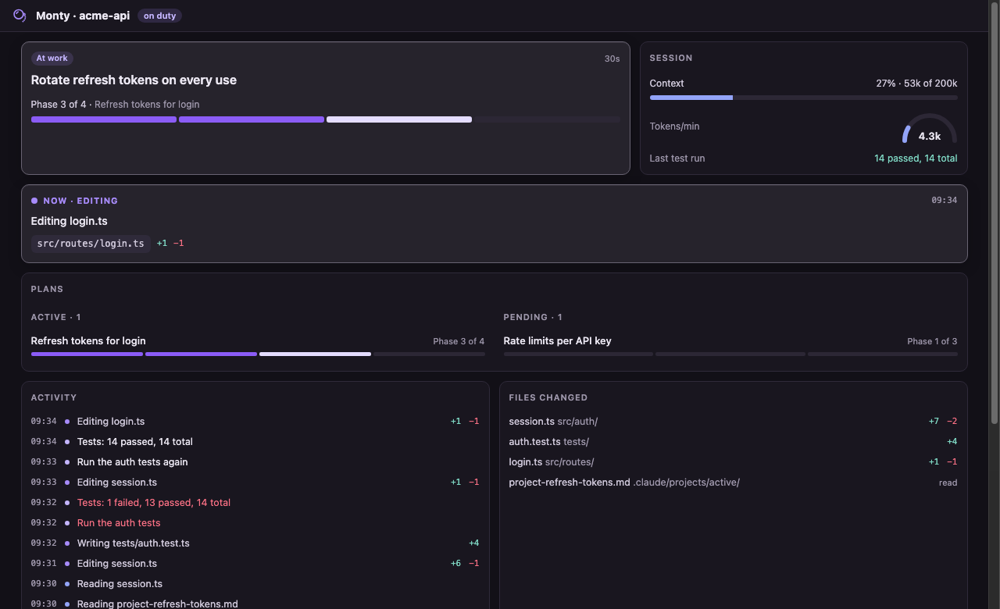

# Monty · Keep an eye on your AI

Tired of reading markdown? Me too 🥱

Monty watches sessions from Claude Code, Codex CLI, opencode, Cline, Roo Code and Copilot Chat, along with the plans in your repos, and reports progress in VS Code and the Mac menu bar. View your AI coding progress with nifty visual widgets and read markdown files like a human. Monty is 100% local and read only.

**Install:** search "Monty" in the VS Code Extensions view, or see the [extension's page](vscode/README.md) for what it does, privacy and settings.



## How it fits together

One local core, several thin surfaces.

```
agent session records ─────────┐
(Claude Code, Codex, opencode, ├─> core (Node, src/) ── HTTP/SSE on 127.0.0.1:4747 ──> VS Code extension (vscode/)
 Cline, Roo, Copilot Chat)     │                                                  ├─> Mac menu bar app (menubar/MontyApp/)
plans and config in your repos ┘                                                  └─> browser panel (web/, for development)
```

- `src/`: the core. Node built-ins only, no runtime dependencies. Each agent has a reader in `src/agents/` that feeds one shared session model (`model.ts`); the core also reads plans (`projects.ts`) and AI tool config (`setup.ts`), and serves state on localhost only (`server.ts`).
- `web/`: the panel. Plain HTML, CSS and JS with no build step; the same page runs in VS Code webviews and a browser tab.
- `vscode/`: the extension. It bundles the core and starts it with VS Code's own Node.
- `menubar/MontyApp/`: the menu bar app. Swift, built with SwiftPM, with no Xcode project.

## Develop

```
npm install
npm test               # core tests
npm run dev            # build and start the core; browser panel at http://127.0.0.1:4747/?repo=<path>
npm run scan           # print what Monty sees from the current folder

cd vscode && npm install && npm test && npm run package    # builds monty.vsix with the core bundled
code --install-extension vscode/monty.vsix

menubar/MontyApp/build.sh   # local menu bar build (ad-hoc signed)
```

To try it without your own sessions, `node docs/demo/make-demo.mjs /tmp/monty-demo` builds two fictional repos with a Claude Code and a Codex session; the script's header says how to point the core at it.

Settings for the core come from environment variables: `MONTY_PORT` (4747), `MONTY_PROJECTS` (folders whose repos are all scanned; by default only repos open in VS Code), `MONTY_CLAUDE_PROJECTS` (session log folder), `MONTY_LIVE_HOURS` (3), `MONTY_CONTEXT_WINDOW` (200000), `MONTY_AGENTS` (which agents to read; default all), and `MONTY_CODEX_DIR`, `MONTY_OPENCODE_DIR`, `MONTY_CLINE_DIR`, `MONTY_EDITOR_DIRS` to point at non-standard folders.

## Principles

- **Local only.** The core binds 127.0.0.1 and never sends session content anywhere. Session logs contain code, prompts and secrets.
- **Read-only.** Monty never writes to `~/.claude` or to your repos. The one exception is installing the menu bar app when you click Install.
- **Degrade, don't crash.** No agent publishes its log format. Readers are built from each tool's source, unknown lines are skipped, and a reader that fails is switched off without taking the others with it.
- **Guesses say so.** "Probably awaiting your permission" is a timing guess and reads as one.
- **Mind the manners.** Monty speaks as a monocled butler: dry, brief, never in the way of the facts. Status tags stay plain; the voice lives in the lines around them.

## License

[MIT](LICENSE). Made by [Adiv Maimon](https://adivmaimon.com).
