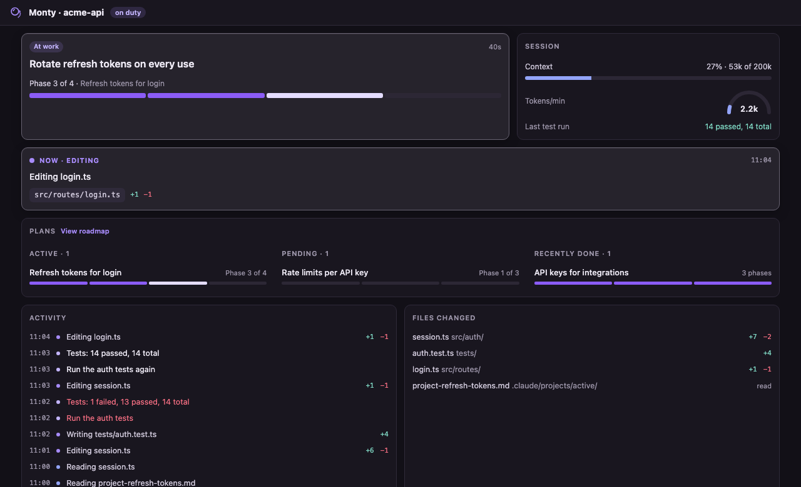
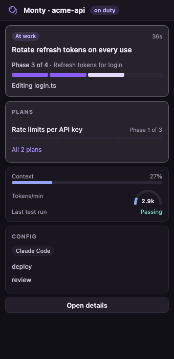
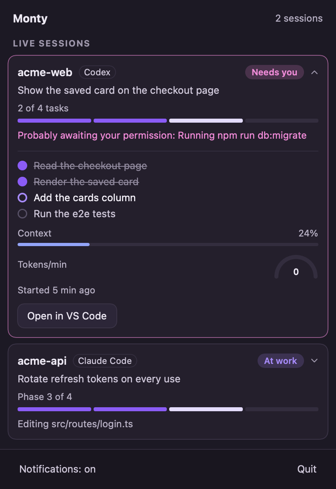
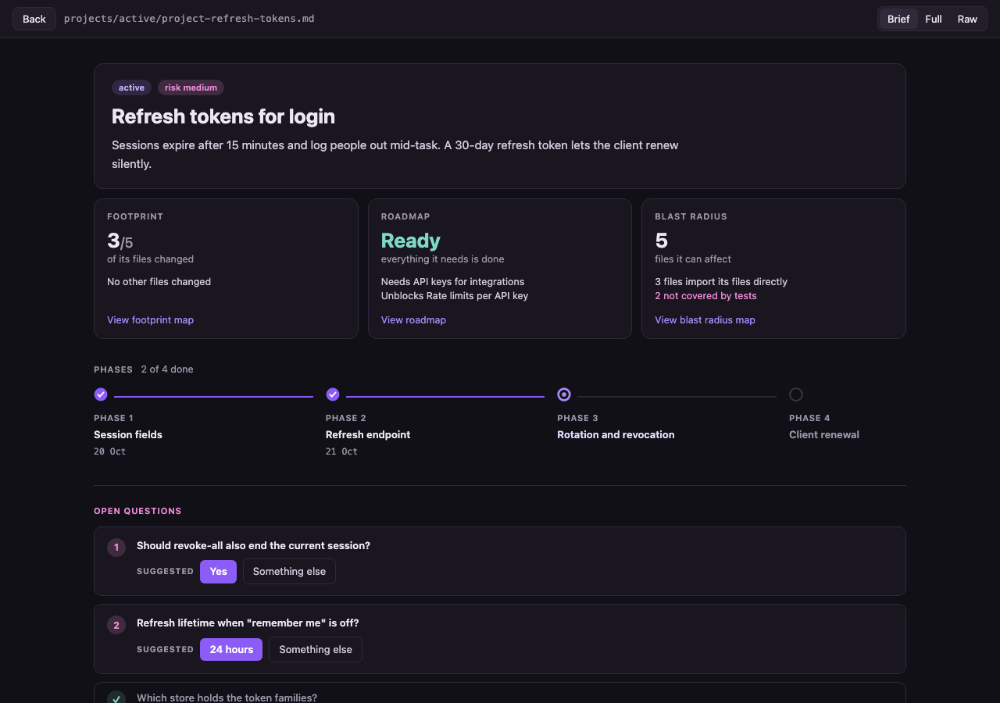
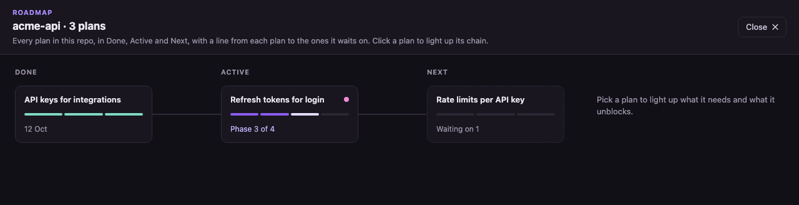
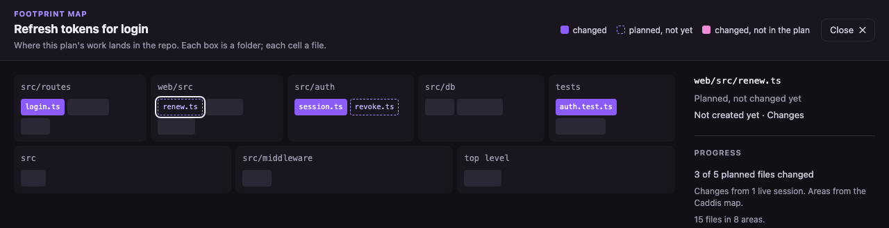
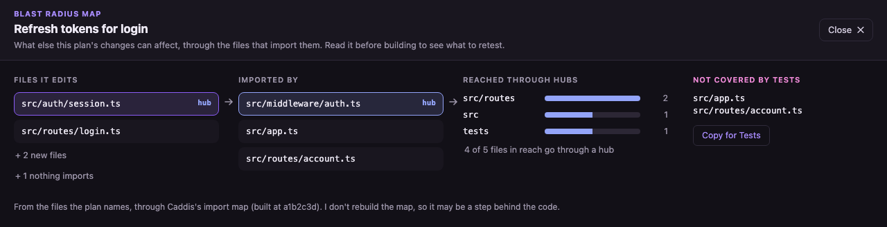

# Monty · Keep an eye on your AI

Tired of reading markdown? Me too 🥱

Monty watches sessions from Claude Code, Codex CLI, opencode, Cline, Roo Code and Copilot Chat, along with the plans in your repos, and reports progress in VS Code and the Mac menu bar. View your AI coding progress with nifty visual widgets and read markdown files like a human. Monty is 100% local and read only.

<table>
  <tr>
    <th colspan="2">The details view</th>
  </tr>
  <tr>
    <td colspan="2">Everything about the session in one tab: where it is in the plan, what it's doing right now, context and tokens, the last test run, activity and files changed.</td>
  </tr>
  <tr>
    <td colspan="2" align="center"></td>
  </tr>
  <tr>
    <th width="50%">In VS Code's sidebar</th>
    <th width="50%">In the Mac menu bar</th>
  </tr>
  <tr>
    <td>The short version for the open repo: state, progress, what it's doing, context.</td>
    <td>Every live session at a glance, from any app. The monocle taps the glass when one needs you.</td>
  </tr>
  <tr>
    <td align="center" valign="top"></td>
    <td align="center" valign="top"></td>
  </tr>
  <tr>
    <th colspan="2">Markdown in human format</th>
  </tr>
  <tr>
    <td colspan="2">Any markdown file opens as a page you can actually read. A plan opens in Brief: status, risk, goal, where it sits on the roadmap, how far its files have changed, a phase stepper and its open questions, which you can answer with one click. Full shows the whole document; Raw, the source.</td>
  </tr>
  <tr>
    <td colspan="2" align="center"></td>
  </tr>
  <tr>
    <th colspan="2">Roadmap</th>
  </tr>
  <tr>
    <td colspan="2">Every plan in the repo in Done, Active and Next, with a line to the plans each one waits on. Click one to light up what it needs and what it unblocks.</td>
  </tr>
  <tr>
    <td colspan="2" align="center"></td>
  </tr>
  <tr>
    <th colspan="2">Footprint map</th>
  </tr>
  <tr>
    <td colspan="2">Where a plan's work lands in the repo: the files it lists, which have changed, and changes it never mentions.</td>
  </tr>
  <tr>
    <td colspan="2" align="center"></td>
  </tr>
  <tr>
    <th colspan="2">Blast radius map</th>
  </tr>
  <tr>
    <td colspan="2">Before a plan is built, what else its changes can affect through the files that import them, and which of those no test covers. Needs a <a href="https://github.com/adivmaimon/caddis">Caddis</a> import map; without one it stays out of the way.</td>
  </tr>
  <tr>
    <td colspan="2" align="center"></td>
  </tr>
</table>

## What you get

- **A sidebar for the open repo.** The session's state (at work, needs you, your move, all done), the plan it's working through as a progress bar, what it's doing right now, context used, and whether the last test run passed.
- **A details view** with the lot: activity, files changed, every plan in the repo, and the repo's AI setup (instructions files, the rules in them, skills, commands, guardrails).
- **Plans you can read.** Every `.md` opens in a readable view (search results and Go to Line still open the text at the line). Plans open in Brief, the page that says what matters now; Full has the whole document with a table of contents; Raw is the source. Mermaid diagrams, `chart` and `flow` blocks, and GitHub callouts are drawn, and it updates live as the agent ticks off phases.
- **What changed since you last looked.** When an agent edits a plan, the sections it changed are marked the next time you open it, until you mark them seen.
- **Answer open questions in one click.** Take the plan's suggested answer or write your own; Monty writes it under the question with the date, and Undo takes it out.
- **Hover a file reference** in a plan to see the lines it points at, or a link to another plan to see its status and progress.
- **Maps for a plan.** The Roadmap shows how the repo's plans depend on each other. The Footprint map shows where a plan's work lands and what changed outside it. The Blast radius map shows what else its changes can affect, for repos with a [Caddis](https://github.com/adivmaimon/caddis) import map.
- **Plans in the editor.** The explorer marks the active plan's files: changed (●), not yet (○), changed outside the plan (◆). A line at the top of a file names the plan changing it and earlier plans that did, and the status bar shows the plan and its phase. The details view maps which plans changed which files.
- **Follow mode** (off until you turn it on). Each file the agent changes opens beside your editor with the new lines highlighted for a moment.
- **Explorer dots** on files the session changed (●) or read (·).
- **A Mac menu bar app** (optional). The monocle's rim fills as the plan progresses, a dot appears when a session needs you, and a notification says so too. Monty offers to install it the first time you open VS Code on a Mac.

## Which agents

| Agent | Where Monty reads it | Good to know |
|---|---|---|
| Claude Code | `~/.claude/projects` | The most complete: todo lists, skills in use, permission guesses. |
| Codex CLI | `~/.codex/sessions` (or `$CODEX_HOME`) | Codex doesn't record approval requests, so "needs you" is a timing guess and says "probably". |
| opencode | `~/.local/share/opencode` (or `$XDG_DATA_HOME`) | Both the database (1.2 and later) and the older JSON files. |
| Cline | VS Code's extension storage, and `~/.cline/data` | Cline 4 keeps sessions in one place or the other depending on the build; both are read. |
| Roo Code | VS Code's extension storage | Roo asks before every step, so a step only counts as waiting after a few seconds. A custom storage path isn't followed. |
| Copilot Chat | VS Code's workspace storage | VS Code saves chats about once a minute, so Monty can trail the chat panel by up to a minute. |

Cursor, Windsurf and VSCodium are covered too, for the extensions above that run in them. When more than one agent is about, each session carries a small label saying which.

## Privacy

Monty reads two things on your machine: your agents' session records (the folders above) and the plan and config files in your repos. It runs a small local server on `127.0.0.1:4747` for VS Code and the menu bar app to talk to. Nothing leaves your machine: no telemetry, no accounts, no cloud. It never opens the credential files that sit beside some of those records.

The one network request Monty ever makes is downloading the menu bar app from this repo's GitHub Releases, and only when you click Install. It checks Apple's signature on the download before installing it.

Monty never writes to any agent's folders, and writes to your repo only when you answer a plan's open question: one dated line under it, which Undo removes. Its own caches (which plans changed which files, what you last read) live in Monty's storage, never in your repo.

## How progress works

When the agent keeps a task list (Claude Code's todos, Codex's plan, Cline's focus chain, Roo's todo list), that is the progress bar. Otherwise progress comes from your plans. Monty reads plan files in:

- [Caddis](https://github.com/adivmaimon/caddis) (`.caddis/projects/`), and `.claude/projects/{active,completed,parked,cancelled}/*.md`, using `### Phase N` headings and ` - DONE (date)` markers
- [OpenSpec](https://github.com/Fission-AI/OpenSpec) (`openspec/changes/*/tasks.md`)
- [Spec Kit](https://github.com/github/spec-kit) (`specs/*/tasks.md`)
- [Kiro](https://kiro.dev) (`.kiro/specs/*/tasks.md`)

## Settings

| Setting | Default | What it does |
|---|---|---|
| `monty.projectRoots` | `[]` | Folders whose repos are always watched, e.g. `~/Projects`. Empty: just the repos open in VS Code. |
| `monty.appPath` | `/Applications/Monty.app` | The menu bar app to start with VS Code. Empty never starts it. |
| `monty.port` | `4747` | Port of the local server. |
| `monty.planBlame` | `false` | Name the plan above each block of code on screen, from git blame. |
| `monty.readableMarkdown` | `true` | Open `.md` files in the readable view. Opens that land on a line (a search result, Go to Line) stay as text so you can edit there. |

Commands: **Monty: Open details**, **Monty: Toggle follow mode**, **Open readable view** (on any `.md`).

## Good to know

- **None of these agents publish their log formats.** Monty reads them defensively, built from each tool's source code, but an update can change what it sees. If something looks off after one, please [open an issue](https://github.com/adivmaimon/monty/issues).
- **Guesses say so.** "Probably awaiting your permission" is a guess from timing, and it reads as one. In Claude Code's auto mode Monty doesn't guess, because nothing asks.
- **The menu bar app is macOS only.** Everything else works on macOS, Windows and Linux.

## License

MIT. Made by [Adiv Maimon](https://adivmaimon.com). Source and issues: [github.com/adivmaimon/monty](https://github.com/adivmaimon/monty).
